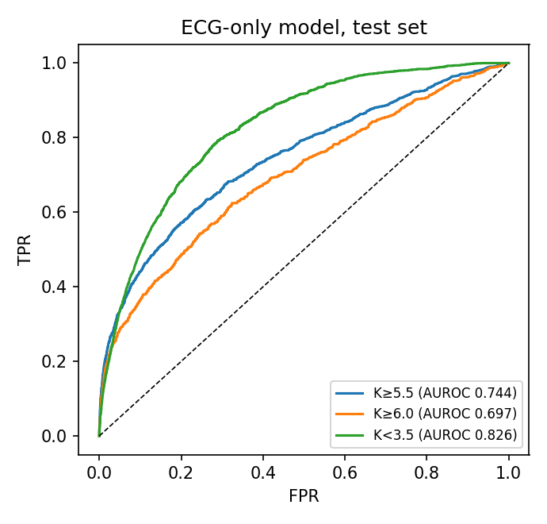
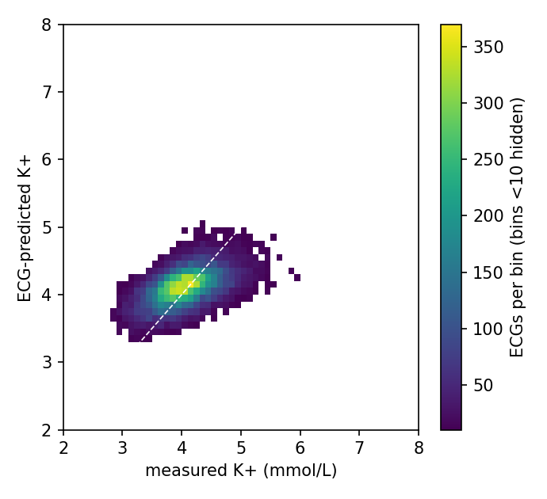
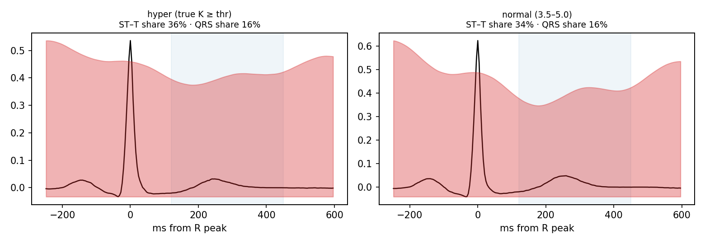
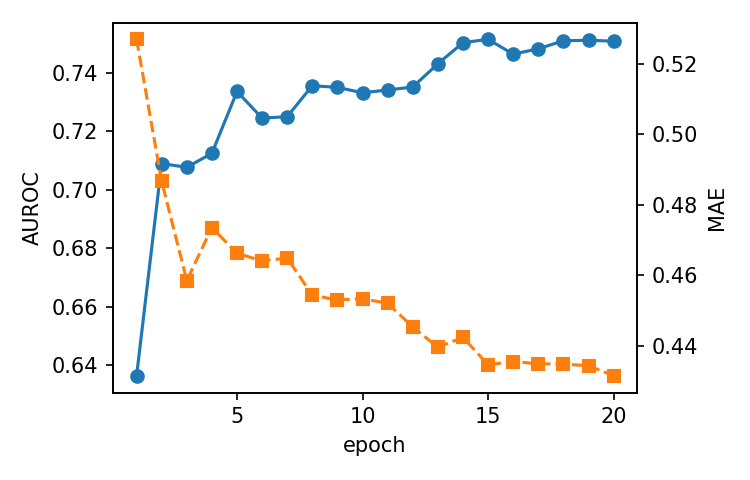

# Results — Potassium (Hyperkalemia) from the 12-lead ECG

*MIMIC-IV-ECG waveforms + MIMIC-IV potassium within ±60 min (hemolyzed samples excluded). Patient-level split.
Aggregate results only; cells with fewer than 10 are suppressed.*

## Cohort
| | |
|---|---|
| ECGs with a matched K+ | 235,823 |
| Patients | 103,229 |
| Waveforms used (train / val / test) | 188,841 / 23,160 / 23,682 |
| K ≥ 5.5 / K < 3.5 prevalence | 5.43% / 7.82% |
| Median K+ · median |ECG–lab time gap| | 4.1 mmol/L · 19 min |

## Test performance (ECG only — no labs, no demographics)
| Target | n positive | prevalence | AUROC (95% CI) | AUPRC | Sens @ 90% spec |
|---|---|---|---|---|---|
| K ≥ 5.5 | 1244 | 0.053 | 0.744 (0.729–0.761) | 0.252 | 0.441 |
| K ≥ 6.0 | 759 | 0.032 | 0.697 (0.675–0.720) | 0.143 | 0.365 |
| K < 3.5 | 1947 | 0.082 | 0.826 (0.817–0.835) | 0.326 | 0.493 |

**K+ regression:** MAE 0.429 mmol/L · RMSE 0.675 · Pearson r 0.464 · within ±0.5 mmol/L 72.5%

## Deep model vs classical ECG measurements
| Model | AUROC (K ≥ 5.5) |
|---|---|
| 1D ResNet on raw 12-lead ECG (this work) | 0.744 (0.729–0.761) |
| XGBoost on ECG-machine intervals/axes (baseline) | – |

## Where does the model look? (population Grad-CAM, R-peak aligned)
| Group | beats | Grad-CAM share in ST–T (120–450 ms) | share in QRS (−50–80 ms) |
|---|---|---|---|
| hyper (true K ≥ thr) | 17016 | 0.358 | 0.159 |
| normal (3.5–5.0) | 25799 | 0.341 | 0.160 |

## Subgroups (K ≥ 5.5)
| attribute | group | n | n_positive | auroc | mae |
|---|---|---|---|---|---|
| sex | F | 11386 | 534 | 0.721 | 0.425 |
| sex | M | 12296 | 710 | 0.761 | 0.432 |
| age_group | 18-39 | 2197 | 57 | 0.665 | 0.363 |
| age_group | 40-64 | 8856 | 478 | 0.753 | 0.421 |
| age_group | 65-79 | 7673 | 430 | 0.736 | 0.444 |
| age_group | 80+ | 4956 | 279 | 0.739 | 0.447 |

## Training
Best epoch 15 of 20 · best val AUROC 0.751

